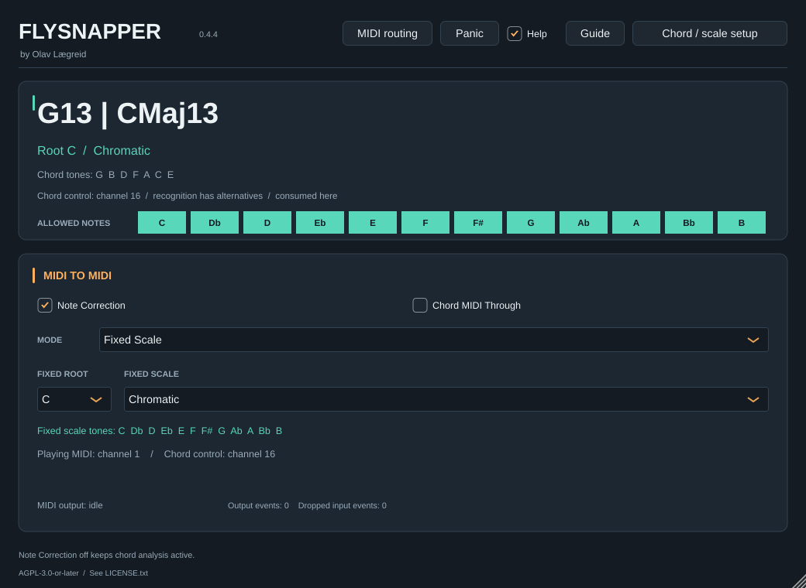

# Linux-kontroll av 0.4.4

Alle fire native testgrupper bestod med 21 utvalgte kilde-/test-/byggfiler
identiske med Git-commit `57240a38575f3d453a69b6c5d90a34aefb56a219`.
Den lokale manifest-generatoren skriver `source_commit: null` uten
CI-metadata; hashene er separat kontrollert mot Git-blobene.

| Kontroll | Resultat |
|---|---|
| Core | 2 203 740 assertions, inkl. nye rekkefølgeprøver |
| Prosessor/GUI | 21 600 assertions, inkl. faktiske oppdaterte etiketter |
| MIDI-prosessor | 318 633 kontroller / 21 tilfeller / 3 171 CSV-rader |
| Kompilert VST3 | 22 060 rapportkontroller / 30 tilfeller / 1 762 CSV-rader |
| Python | 199 bestått, 2 forventede Linux-skip, 201 totalt |

VST3-programmets stdout teller også sluttkontrollen ved rapportskriving,
altså 22 061. Core inkluderer 30 eksplisitte harmoniske eksempler,
durakkorder i alle tolv grunntoner og tre omvendinger, samt bevaring av
alle mottatte toneklasser for 52 typer × 12 grunntoner. GUI-prøven dekker
faktiske tekster, omvendinger, ekstensjoner og utelatelser.

Bildet er kontrollert ved 1040 × 760: første tolkning G13 gir
G B D F A C E. Den alternative CMaj13-tolkningen endrer ikke hvilken
tolkning tonelinjen følger. Fixed Scale/C/Chromatic i kontrollene er et
separat lagret modusvalg i dette eksemplet.

Begge rå MIDI-regresjonsfiler er byte-identiske med 0.4.3; GUI-hjelperen
endrer ingen notehendelser. MIDIEngine, PluginProcessor og Reference-
filene er også byte-identiske med forrige leveranse. Det gjelder de
kontrollerte filene/strømmene, ikke alle tenkelige vertsscenarier.

Den avbrutte lokale byggingen ble fullført etter at miljøet kom tilbake.
Arkivet inneholder den fullførte kjøringens resultater og kontrollsummer.
Testeksekverbare og Linux-bundlen er utelatt her; manifestene registrerer
deres hasher. Dette er Linux-bevis, ikke en utført Ableton Live-prøve.
